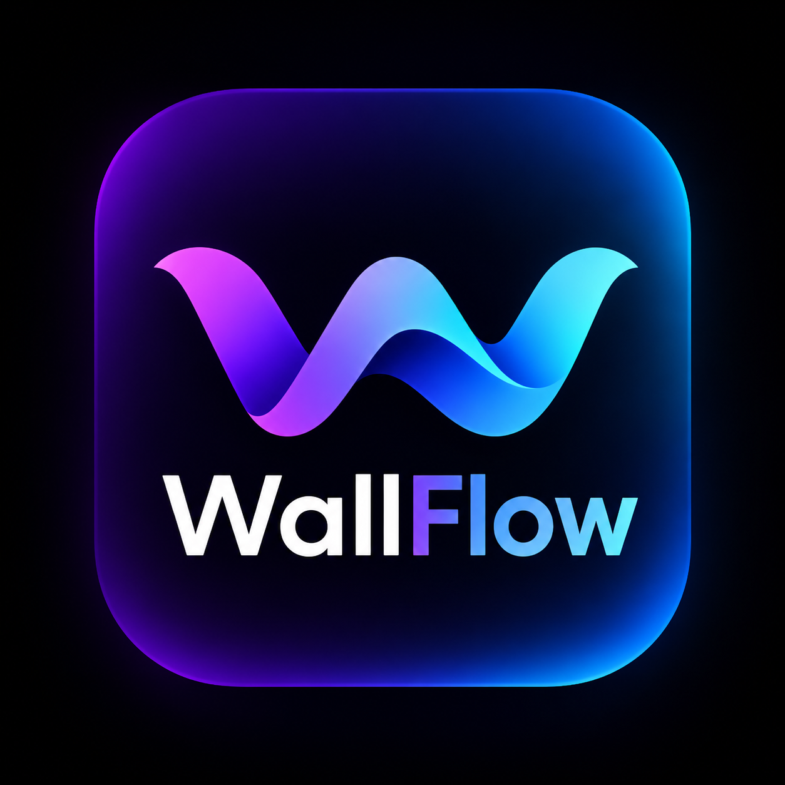
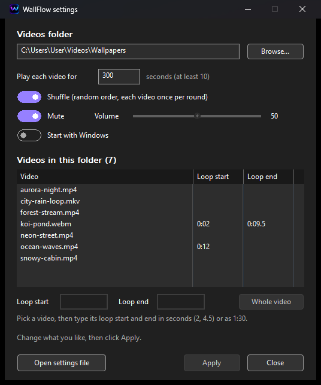
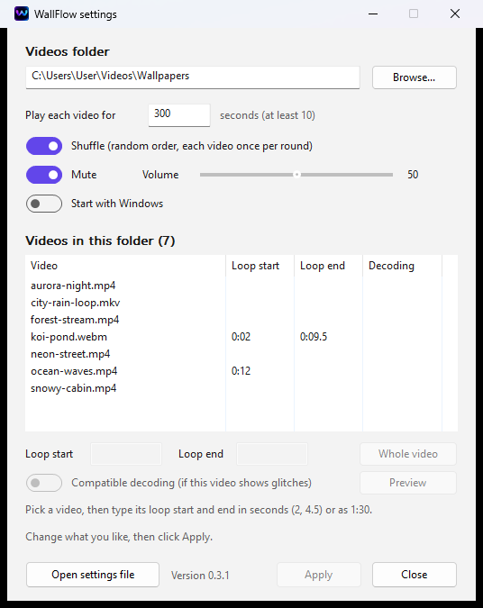

<p align="center"></p>

# WallFlow

[](https://github.com/Niranjen99/WallFlow/actions/workflows/ci.yml)

A lightweight live wallpaper app for Windows: it plays videos behind the desktop icons, rotates through a folder of videos with seamless switches, and pauses whenever a maximized or full-screen window (such as a game) covers the screen.

**Status: work in progress.** WallFlow plays videos behind the desktop icons, decoded on the GPU. It loops a video (or a start-to-end part of it), or rotates through a folder, without a black frame or a seek stall at the switch, and notices videos added to or deleted from the folder. It pauses while a maximized or full-screen window covers the screen, the PC is locked or the display is off, lives in the system tray, and recovers by itself when Explorer restarts. A settings window (light or dark, following Windows) changes everything with one Apply, and the same settings live in a JSON file you can also edit by hand. See the [Roadmap](#roadmap).

**Tech stack:** C++20, Win32 API, libmpv (FFmpeg, Direct3D 11), nlohmann/json, MSVC, CMake, GoogleTest, GitHub Actions.

## Download and use

Get the zip from the [latest release](https://github.com/Niranjen99/WallFlow/releases/latest), unzip it anywhere and run `wallflow.exe`. Nothing is installed.

- Needs Windows 10 or 11, 64-bit, and a graphics driver (any current NVIDIA, AMD or Intel driver; libmpv needs the `vulkan-1.dll` those drivers install).
- WallFlow lives in the system tray. Click its icon to open the settings. Right-click it for **Settings...** and **Quit WallFlow**, which gives you your normal wallpaper back.
- The settings window and the tray menu follow the Windows light or dark app theme, and switch live when you change it.

## Settings

| Dark | Light |
|---|---|
|  |  |

Pick a folder, set how many seconds each video plays, shuffle, mute or volume, and start with Windows. Pick a video in the list to give it its own loop: type its start and end in seconds (`2`, `4.5`) or as `1:30`. Nothing changes until you click **Apply** (or press Enter); a typo is shown in red and nothing is applied. Closing with changes not applied asks whether to apply them. Hover over the loop fields for a note on memory: a loop of 4 seconds or less keeps a second video player loaded all the time.

**Preview** shows the selected video on the desktop right away, with the loop and decoding you set but have not applied yet. The folder rotation stops while you look; **Apply** or closing the window brings it back.

**Compatible decoding** (per video): turn it on for a video that shows blocks of wrong colours. See [A driver bug: corrupted blocks at the bottom](#a-driver-bug-corrupted-blocks-at-the-bottom).

The window writes `%APPDATA%\WallFlow\settings.json`, which you can also edit by hand (the open window follows). Saving from the window rewrites the file, so `//` comments in it are lost.

The first start creates `%APPDATA%\WallFlow\settings.json`. Save it and WallFlow applies the change at once: another folder or a new loop range switches over seamlessly, a typo is reported in the log and ignored, and a half-saved file is ignored until it is valid again.

```json
{
  "folder": "C:\\Users\\me\\Videos\\Wallpapers",
  "interval": "5:00",
  "shuffle": true,
  "mute": true,
  "volume": 50,
  "lock_screen_picture": false,
  "start_with_windows": true,
  "videos": {
    "goku-hero.mp4": { "start": "0:02", "end": "0:05" },
    "glitchy.mp4": { "compatible_decoding": true }
  }
}
```

| Setting | Meaning | Default |
|---|---|---|
| `folder` | Folder of videos to play (not its subfolders). Backslashes are written `\\` in JSON. | none: your normal wallpaper stays |
| `interval` | Playing time per video before the next one, at least 10 s. Paused time does not count; the switch waits for the end of the current loop. | `"5:00"` |
| `shuffle` | Random order, each video once per round, never the same one twice in a row. | `false` |
| `mute`, `volume` | Muted means the audio is not even decoded. Volume 0 to 100. | `true`, `50` |
| `start_with_windows` | Start when you log in (current user only, no admin rights). | `false` |
| `videos` | Per-video settings by file name: loop `start`, `end` or both, as seconds (`90`) or text (`"1:30"`); `compatible_decoding` decodes the video with Vulkan instead of DirectX. | whole video, DirectX |
| `lock_screen_picture` | Reserved for the lock screen feature (not active yet). | `false` |

Times can be `90`, `"1:30"` or `"1:02:03.5"`. `//` comments are allowed.

## Build and run

Needs Visual Studio 2022 or later with the **Desktop development with C++** workload and the **C++ CMake tools for Windows** component.

**In Visual Studio:** File > Open > Folder, pick the `WallFlow` folder, choose the `Debug` preset, then Build > Build All.

**From a command prompt:** open the *x64 Native Tools Command Prompt* (Start menu, under Visual Studio), then:

```bat
cd path\to\WallFlow
cmake --preset debug
cmake --build --preset debug
ctest --preset debug
build\debug\wallflow.exe "C:\Videos\clip.mp4"
build\debug\wallflow.exe "C:\Videos\clip.mp4" --start 0:02 --end 0:05
build\debug\wallflow.exe --folder "C:\Videos" --interval 5:00 --shuffle
```

The first configure downloads libmpv (about 32 MB) and nlohmann/json and checks their SHA-256. With no arguments, WallFlow plays what settings.json says. A video or folder on the command line overrides the file for what plays (handy for testing): `--start` and `--end` (seconds, `m:ss` or `h:mm:ss.s`) loop only that part of the video; without them the whole video loops. `--folder` rotates through the videos in a folder (not its subfolders): each one plays for at least `--interval` of playing time (default 5 minutes, paused time does not count) and the switch happens at the end of its current loop. `--shuffle` plays them in random order, each once per round. WallFlow runs in the system tray. Right-click its icon and choose **Quit WallFlow** to stop it and get your normal wallpaper back.

Presets: `debug`, `release`, and `asan` (Debug with AddressSanitizer, which CI also runs). The `debug` and `release` builds link the C++ runtime statically, so the exe runs on PCs without the Visual C++ Redistributable.

A release is built by pushing a tag: `git tag v0.1.0 && git push origin v0.1.0` runs `.github/workflows/release.yml`, which builds, tests, zips `wallflow.exe`, `libmpv-2.dll` and the licence files, and publishes a GitHub Release.

## Layout

```
src/
  main.cpp         the program's entry point
  wallflow/        everything else, built as a library so tests can link it
    desktop_layout   where the wallpaper window must go (pure logic, unit tested)
    coverage         the pause rule: is a real window covering the monitor? (pure logic, unit tested)
    loop_range       checks a loop start/end against the video, parses typed times (unit tested)
    command_line     the command-line arguments (unit tested)
    playlist         folder scan, play order, shuffle without repeats (unit tested)
    settings         settings.json: parse, validate, write (unit tested)
    settings_form    what the settings window's fields mean: times, loops, list rows (unit tested)
    rotation         when to switch and when to preload, on a fake clock in tests (unit tested)
    win/             Win32 code: desktop attachment, wallpaper window, tray icon, window
                     events, libmpv player, two-player video engine, folder watcher,
                     settings file, settings window, autostart, theme, app
  wallflow.rc.in   icon and version info for the exe; wallflow.manifest: modern controls
assets/            logo and app icon (tools/make_icon.py builds the .ico from the logo)
docs/              screenshots
tests/             GoogleTest unit tests (the player tests run headless, on CI too)
bench/             loop_bench: measures the pause at a loop point, two-player vs mpv's A-B loop
.github/workflows/ CI (Debug and AddressSanitizer builds); release.yml publishes a zip for a v* tag
```

## How it gets behind the desktop icons

Windows has no official API for this. WallFlow sends Explorer the undocumented message `0x052C`, which makes it create a wallpaper layer behind the icons, then makes its own window a child of the right desktop window:

- **Windows 11 24H2 and later:** a child of `Progman`, placed directly below the icon view (`SHELLDLL_DefView`). `Progman` has no off-screen drawing surface on these versions (`WS_EX_NOREDIRECTIONBITMAP`), so the window is created as a layered window, which gets its own surface.
- **Older versions:** a child of the `WorkerW` window that sits behind the one holding the icons.

The choice is made by a pure function over a snapshot of the window tree, so both layouts are unit tested.

## How it knows when to pause

Nothing is polled. WallFlow subscribes to Windows' accessibility events (`SetWinEventHook`): focus changes, windows shown, hidden, minimized, cloaked, moved or resized. A burst of events (dragging a window sends dozens) is collapsed into one check 200 ms after it ends. The check takes a snapshot of the visible windows and asks a pure, unit-tested function whether one covers the monitor:

- **Covers:** a maximized window on that monitor, or a window as big as the whole monitor (full-screen games and videos).
- **Does not:** the desktop and taskbar, minimized windows, click-through overlays, and *cloaked* windows. Windows 11 keeps suspended apps and some system windows "visible" but undrawn; on the development machine a cloaked Settings app was maximized and a cloaked system window was exactly screen-sized, so without this filter the wallpaper would never play.

Lock/unlock (`WTSRegisterSessionNotification`) and display on/off (`RegisterPowerSettingNotification`) are pushed by Windows the same way.

## How it loops without a gap

The obvious way to loop part of a video is to seek back to the start at the end (mpv's built-in A-B loop does this). A seek has to decode from the keyframe before the start point, so the picture freezes for a moment at every loop.

WallFlow uses two players instead, each drawing into its own wallpaper window. The two windows are on top of each other, and only one is visible:

1. Player A plays. Player B has already loaded the same video, sought exactly to the loop start, and waits there, paused, in a fully transparent window.
2. At the loop end, A pauses on its last frame (`keep-open`, so the picture never goes black) and mpv reports `eof-reached` as an event.
3. WallFlow starts B, makes B's window opaque, then makes A's transparent. The screen goes from A's last frame straight to B's first.
4. A rewinds to the loop start, invisibly, and becomes the waiting player.

Two details made it reliable:

- **Which "frame ready" belongs to which seek?** mpv's `playback-restart` event doesn't say which command caused it, and one from an earlier seek can still be queued. Each load and seek gets its own reply id, and a restart only counts once mpv has replied to that command.
- **A bad loop range never breaks playback.** A start past the end of the file, or a loop shorter than 0.5 s, falls back to the whole video. That can only be checked once the file is loaded and its length is known.

Folder rotation uses the same swap, with the next video in the waiting player.

**The waiting player is only loaded when it is needed.** A loaded 4K player holds a pool of decoded frames, so two loaded players double the memory. Instead, a timer loads the waiting player 2 seconds before the loop end, and after the swap the old player unloads and frees its decoder. Because paused time does not count towards the rotation interval, it is already certain 2 seconds early whether the end restarts the loop or switches to the next video, so the right one is loaded. The timer is stopped while paused and re-armed on resume with the real time left. Loops of 4 seconds or less keep both players loaded: there is no time to unload in between.

## How the settings window works

- **Plain Win32, laid out in code.** No UI framework: the exe stays under 1 MB with no extra DLLs. Every position is written at 96 DPI and scaled with the monitor's DPI, and dragging the window to a monitor with other scaling lays it out again (`WM_DPICHANGED`).
- **Light and dark.** The title bar uses the documented `DWMWA_USE_IMMERSIVE_DARK_MODE`. Buttons, text fields, the list and its scrollbars use the dark theme classes Windows ships for File Explorer (`DarkMode_Explorer`, `DarkMode_CFD`, `DarkMode_ItemsView`). Colours come from answering `WM_CTLCOLOR*`. A standard checkbox ignores the text colour in dark mode, so the switches are owner-drawn (`BS_OWNERDRAW`), and the volume slider is custom-drawn (`NM_CUSTOMDRAW`). A light/dark change arrives as `WM_SETTINGCHANGE` with `"ImmersiveColorSet"`, and the window repaints in the new theme.
- **One path for every change.** The window keeps two copies of the settings: what WallFlow uses now, and what the window shows with your edits. Apply checks the fields and hands the edited copy to the app. The app saves it to settings.json and applies it through the same code as a hand edit, so a new loop or folder still switches seamlessly. The folder watcher then reports that write, but the file matches what is already applied, so nothing happens twice.
- **The logic is testable.** What a typed time means, when a loop is too short, and how an edit changes the settings live in `settings_form`, with no window, so they are unit tested.
- **A bug found while testing.** Quitting from the tray while the folder picker was open left WallFlow running with no windows. The picker runs its own message loop, which swallowed the `WM_QUIT` that ends the main loop. Now quitting closes the picker (`IFileDialog::Close`), and the main loop also stops on a flag set when the controller window is destroyed, so a swallowed `WM_QUIT` can't leave it waiting forever.

## A bug found by a user: the NVIDIA overlay

The first release paused forever on a PC with the NVIDIA app installed. Its GeForce Overlay keeps a screen-sized window open even while the overlay is closed: layered, at opacity 0, and not click-through. The pause rule saw "a window as big as the monitor" and paused. Now a layered window whose opacity (`GetLayeredWindowAttributes`, `LWA_ALPHA`) is 0 never counts as covering the screen. When the overlay is opened with Alt+Z its opacity rises and the wallpaper pauses as it should. A unit test covers both cases.

## A driver bug: corrupted blocks at the bottom

A user's 4K H.264 video showed a band of orange and purple blocks along the bottom of the screen. To find out whether the file or the decoder was at fault, a small libmpv script saved the same frame with each decoder and compared the pictures, pixel by pixel, with software (CPU) decoding:

| Decoder (RTX 3070) | Mean difference, bottom 10% of the frame |
|---|---|
| `d3d11va`, `dxva2` (DirectX video) | 17.5 |
| `nvdec` (NVIDIA CUDA), `vulkan` | 0.0 (identical to software) |

The top 90% was identical for every decoder, so the file is fine: the GPU driver's DirectX decode path gets this stream wrong. Then the real cost of each fix, measured in WallFlow on that video (20 s average):

| Setup | CPU (12 cores) | Private memory | Picture |
|---|---|---|---|
| DirectX `d3d11va`, zero copy (default) | 1.2% | 698 MB | corrupted |
| `vulkan-copy` | 2.7% | 951 MB | correct |
| `nvdec-copy` | 2.4% | 1494 MB | correct |
| Vulkan renderer + Vulkan decoding | 2.1% | 1298 MB | correct |

DirectX stays the default because it is the cheapest and correct for almost every video. A video that shows the bug gets **Compatible decoding**: mpv's `hwdec=vulkan-copy`, passed as a per-file option with `loadfile`, so it applies to that video only and the next one is back on DirectX. Vulkan works on NVIDIA, AMD and Intel (not only NVIDIA like `nvdec`) and needs no change to the renderer. Without Vulkan video support mpv falls back to software decoding, which is slower but also correct.

## How it watches the folder

A background thread waits on `ReadDirectoryChangesW` (overlapped, together with a stop event, so quitting cancels it cleanly). It does not parse what changed: any change posts one message to the UI thread, which rescans the folder 1 second after the last change (copying a file sends many events). New videos join the shuffle round at random places; deleted ones never play again; in order, playback continues after the last video played even if that one was deleted. A video that fails to load is skipped. The first read is issued in the constructor, before the thread starts, because Windows only records changes from the first call on: a unit test caught a file added right after start being missed.

## Measured so far

Windows 11 build 26300, NVIDIA RTX 3070, 1920x1080 monitor, release build (2026-11-27):

| | Value |
|---|---|
| No video loaded | 42 KB executable, 1.5 MB private memory, 0 ms CPU over 30 s |
| Playing a 4K H.264 video | 0.4% of total CPU (12 logical cores), GPU video decoder 14.9%, GPU 3D 2.1% |
| Paused (4K video loaded, covered by a maximized window) | 31 ms of CPU in 30 s, GPU video decoder 0%, GPU 3D 0% |
| Memory while playing 4K | 177 MB working set, about 345 MB private; mpv with nothing loaded: 19 MB |
| Same video decoded on the CPU instead | 61.5% of one core and 681 MB private: why hardware decoding is on |

Almost all of the memory is the decoder's pool of 4K frames (about 12 MB each). A 1080p video needs about a quarter of that. Memory with the two-player engine, same 4K video (24 s long, looping), private memory sampled every 0.5 s for 42 s:

| | Private memory |
|---|---|
| One player (before the engine) | about 345 MB |
| Both players loaded all the time (first engine version) | 694 MB |
| Waiting player loaded only 2 s before the loop end (now) | 410 MB mean, 348 MB min, 708 MB peak |

The peak lasts the 2-second preload plus about 3 seconds until mpv has freed the old decoder.

**Pause at a loop point**, measured with `bench/loop_bench.exe` (10 loops per video, 4K H.264, GPU decoding, no drawing, so the compositor is not included). Overrun = how much longer a loop took than its length in whole frames, i.e. how long the picture stood still too long:

| Video, loop | Two-player (WallFlow) | mpv A-B loop (one player, seek back) |
|---|---|---|
| 30 fps, 2.0 to 5.0 s | 0.2 ms mean, 0.3 ms max | 43.1 ms mean, 43.5 ms max |
| 30 fps, 1.1 to 4.6 s | 0.3 ms mean, 1.2 ms max | 57.0 ms mean, 58.2 ms max |
| 60 fps, 3.3 to 7.7 s | 13.7 ms mean, 14.5 ms max | 113.9 ms mean, 115.2 ms max |

At 30 fps the seek-back loop freezes the picture for one to two frames at every loop, while the two-player swap is under 2 ms. At 60 fps the two-player swap measured 8 to 14 ms on every loop range tried, still under one frame (16.7 ms); the cause of that delay is not identified yet.

```bat
build\release\loop_bench.exe "C:\Videos\clip.mp4" 2 5 10
```

## Troubleshooting

Set `WALLFLOW_LOG` to a file path before starting WallFlow and it logs what it does there, with timestamps (attached, paused and why, playing). Set `WALLFLOW_MPV_LOG` and mpv writes its own detailed log (which decoder was used, whether hardware decoding worked, errors).

## Roadmap

- [x] Project skeleton: CMake presets, unit tests, CI
- [x] A window behind the desktop icons, tray icon, survives an Explorer restart
- [x] Play one video with hardware decoding (libmpv)
- [x] Pause when a maximized or full-screen window covers the screen, while locked, and while the display is off
- [x] Two-player engine: loop between a start and end point with no visible gap
- [x] Rotate through a folder of videos with seamless switches, watch the folder for changes
- [x] Settings file applied live, audio settings, start with Windows, app icon, release zip
- [x] Settings window (follows the Windows light/dark theme live)
- [x] Preview a video before applying; per-video compatible decoding for GPU driver bugs
- [ ] Lock screen picture that matches the wallpaper
- [ ] Measured results: memory, CPU and GPU use, switch gap

## License

WallFlow is licensed under the [GNU General Public License v3.0](LICENSE). It uses [libmpv](https://mpv.io/), whose Windows builds include FFmpeg compiled with GPL components, so the combined program is GPLv3. [THIRD_PARTY.md](THIRD_PARTY.md) lists every component, its licence and where to get its exact source.

The dark tray menu uses two functions that `uxtheme.dll` exports only by number (#135 and #136). They are undocumented; if a future Windows removes them, the menu simply stays light.
